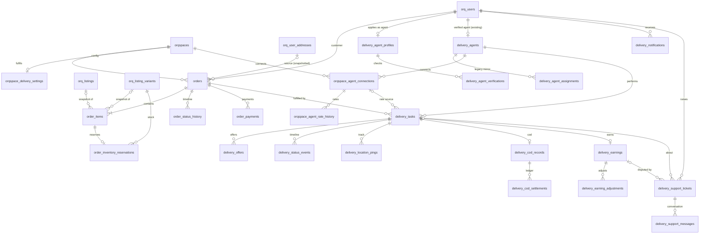

# ORQLAND — Order & Delivery Management: Database Schema Proposal

Status: **Approved with minor technical alignments** (Core Engine Architecture review, 3 Nov 2026; alignments applied — see §10) · Target: `orqland-engine` (PostgreSQL + Drizzle ORM)

This proposal covers the two new workspace modules — **Order Management** and **Delivery Management** — including delivery-agent registration/KYC, workspace–agent connections, assignment, tracking, COD and earnings.

---

## 0. Design principles

1. **Additive only.** No column of an existing ORQLAND table is altered or dropped. New behaviour lives in new tables that reference existing ones. Existing tables only receive normal row writes (listed in §1). This keeps the merge a copy-paste of new files plus three export lines.
2. **Separate state machines.** Order status, payment status, delivery status, COD status and earnings status are independent columns/tables (Mandate 12).
3. **Snapshots over live references.** Prices, taxes, item details, delivery address, per-km rate and distance inputs are copied at the moment they become binding.
4. **History is append-only.** Every status change writes an event row with actor, role, reason and timestamp. Sensitive changes also write an audit row.
5. **Concurrency is enforced in the database.** Stock decrements, connection limits and offer acceptance use conditional updates, row locks and partial unique indexes — never "check then write" in application code alone.
6. **Money** is `numeric(12,2)` in INR (`currency char(3) default 'INR'`); distance is `numeric(8,2)` km; coordinates `numeric(9,6)`.
7. All tables have `id uuid primary key default gen_random_uuid()` (unless noted), `created_at timestamptz default now()`, `updated_at timestamptz default now()`.

---

## 1. Existing ORQLAND tables — integrated, not modified

| Table | How the new modules use it | Writes performed |
|---|---|---|
| `orq_users` | Customer, workspace admin, delivery agent, platform admin identity | Append `DELIVERY_AGENT` to `roles` after successful KYC; never removed automatically |
| `orq_user_addresses` | Source of the delivery address at checkout | None (address is **snapshotted** into the order) |
| `orqspaces` | Fulfilling workspace; `owner_id` is used for workspace-admin authorization | None |
| `orq_listings` | Item being ordered; `listing_type`, `status`, `is_public` validated | None |
| `orq_listing_variants` | Price + inventory source of truth | `remaining_quantity` decremented/restored atomically for `inventory_mode = LIMITED` |
| `delivery_agents` | Anchor row for a verified agent (`user_id` PK) | Row **inserted** on KYC approval (`vehicle_number` = masked value, see Q-3) |
| `delivery_agent_assignments` | Legacy agent↔orqspace mapping | Kept **in sync** (upsert on connect, `revoked_at` on disconnect) so existing code keeps working. New logic reads the new connections table, which keeps full history |

### Why the legacy tables are not enough (and why we don't alter them)

- `delivery_agents` stores `vehicle_number` in plaintext and has no licence, verification, fingerprint or re-KYC fields → covered by the new `delivery_agent_profiles`.
- `delivery_agent_assignments` has a composite PK `(delivery_agent_user_id, orqspace_id)`, so an agent cannot reconnect after a disconnect without overwriting history, and it has no status, initiator, acceptance or rate → covered by the new `orqspace_agent_connections`.
- `orders.delivery_agent_id` (draft) cannot represent reassignment/offer history → covered by `delivery_tasks` + `delivery_offers`.
- `orders.delivery_address_id` (draft) points to a mutable address → replaced by `delivery_address_snapshot`.

---

## 2. New tables — overview

| # | Table | Module | Purpose |
|---|---|---|---|
| 1 | `orders` | Orders | One order per customer per orqspace |
| 2 | `order_items` | Orders | Line items with immutable price/item snapshots |
| 3 | `order_status_history` | Orders | Append-only order status timeline |
| 4 | `order_inventory_reservations` | Orders | Stock held/committed/released per line |
| 5 | `order_payments` | Orders | Payment + refund records (provider-agnostic) |
| 6 | `orqspace_delivery_settings` | Delivery | Per-workspace pickup point, timezone, assignment config |
| 7 | `delivery_agent_profiles` | Delivery / KYC | Agent application, encrypted documents, fingerprints, KYC validity, availability |
| 8 | `delivery_agent_verifications` | Delivery / KYC | Every Surepass check attempt and result |
| 9 | `orqspace_agent_connections` | Delivery | Workspace ↔ agent relationship with lifecycle + current rate |
| 10 | `orqspace_agent_rate_history` | Delivery | Every per-km rate set on a connection |
| 11 | `delivery_tasks` | Delivery | One delivery job for an order (self or agent) |
| 12 | `delivery_offers` | Delivery | Each offer of a task to an agent (assignment attempts) |
| 13 | `delivery_status_events` | Delivery | Append-only delivery timeline |
| 14 | `delivery_location_pings` | Delivery | Agent GPS points (purpose-limited, retention-bound) |
| 15 | `delivery_cod_records` | Delivery / COD | Cash expected / collected / settled per task |
| 16 | `delivery_cod_settlements` | Delivery / COD | Each cash handover entry (ledger) |
| 17 | `delivery_earnings` | Delivery / Earnings | One earning per completed agent task (km × rate snapshot) |
| 18 | `delivery_earning_adjustments` | Delivery / Earnings | Signed adjustments with reason |
| 19 | `delivery_audit_logs` | Shared | Sensitive changes (overrides, rate changes, suspensions, KYC decisions) |
| 20 | `delivery_notifications` | Delivery / Run | In-app notification history with read/unread state (agents and workspace admins) |
| 21 | `delivery_support_tickets` | Delivery / Run | Agent support tickets: delivery issues, earnings disputes, KYC, workspace, technical, security, emergencies |
| 22 | `delivery_support_messages` | Delivery / Run | Ticket conversation, with attachments and internal support notes |

Monthly statements (1st → last day, with CSV download) are computed from `delivery_earnings.period_month` (indexed); a persisted `delivery_statements` table is deferred until payouts are automated.

---

## 3. Order Management tables

### 3.1 `orders`

| Column | Type | Constraints / notes |
|---|---|---|
| id | uuid | PK |
| order_number | varchar(24) | **unique**, public, e.g. `ORD-261101-7K3Q9X` |
| checkout_id | uuid | not null; groups orders created in one checkout (one order per orqspace) |
| customer_id | uuid | FK → `orq_users.id` **on delete restrict** |
| orqspace_id | uuid | FK → `orqspaces.id` **on delete restrict** |
| order_status | `order_status` enum | default `PLACED` |
| payment_method | `order_payment_method` enum | `ONLINE` \| `COD` |
| payment_status | `order_payment_status` enum | default `PENDING` |
| requested_fulfilment | `order_requested_fulfilment` enum | customer choice: `DELIVERY` \| `PICKUP` |
| fulfilment_method | `order_fulfilment_method` enum, nullable | workspace choice at ready stage: `SELF_DELIVERY` \| `AGENT_DELIVERY` \| `PICKUP` |
| currency | char(3) | default `INR` |
| subtotal_base | numeric(12,2) | Σ unit_base_price × qty |
| total_gst | numeric(12,2) | |
| delivery_fee | numeric(12,2) | customer-facing fee (independent of agent earnings) |
| discount_total | numeric(12,2) | default 0 |
| total_amount | numeric(12,2) | check `= subtotal_base + total_gst + delivery_fee - discount_total` |
| buyer_snapshot | jsonb | `{name, phone, email, orqUserId}` at order time |
| delivery_address_snapshot | jsonb, nullable | full address + lat/lng at order time; required when `requested_fulfilment = DELIVERY` |
| source_address_id | uuid, nullable | FK → `orq_user_addresses.id` **on delete set null** (reference only) |
| customer_note | text, nullable | |
| idempotency_key | varchar(64) | client checkout key; unique with `(customer_id, orqspace_id)` |
| rejection_reason / cancellation_reason | text, nullable | |
| cancelled_by_role | `actor_role` enum, nullable | |
| accepted_at, preparing_at, ready_at, dispatched_at, delivered_at, completed_at, cancelled_at | timestamptz, nullable | lifecycle timestamps |
| version | integer | default 1; optimistic concurrency on status changes |
| created_at, updated_at | timestamptz | |

Indexes: `(orqspace_id, order_status, created_at desc)`, `(customer_id, created_at desc)`, `(checkout_id)`, unique `(customer_id, idempotency_key, orqspace_id)` (one checkout key → one order per orqspace).

### 3.2 `order_items`

| Column | Type | Notes |
|---|---|---|
| id | uuid | PK |
| order_id | uuid | FK → `orders.id` **on delete cascade** |
| listing_id | uuid, nullable | FK → `orq_listings.id` on delete set null |
| variant_id | uuid | FK → `orq_listing_variants.id` on delete set null. **Always set** for products — single products (`has_variants = false`) use their engine-created default variant (review §2.1). The column stays nullable only so a later hard delete of a variant cannot break order history |
| listing_type | varchar(20) | snapshot |
| title | varchar(255) | snapshot |
| variant_label | varchar(255), nullable | snapshot (variant `type`) |
| sku | varchar(100), nullable | snapshot |
| image_url | text, nullable | snapshot (first image) |
| inventory_mode | varchar(20) | snapshot (`LIMITED`/`NO_LIMIT`/`TIME_BASED`) |
| quantity | integer | check `> 0` |
| unit_base_price | numeric(12,2) | snapshot |
| gst_percentage | numeric(5,2) | snapshot |
| unit_gst | numeric(12,2) | |
| unit_total_price | numeric(12,2) | |
| line_total | numeric(12,2) | `unit_total_price × quantity` |
| created_at | timestamptz | |

Index: `(order_id)`, `(variant_id)`.

### 3.3 `order_status_history` (append-only)

`id, order_id (FK cascade), from_status (nullable), to_status, actor_user_id (FK orq_users, set null), actor_role, reason, metadata jsonb, created_at` — index `(order_id, created_at)`.

### 3.4 `order_inventory_reservations`

| Column | Type | Notes |
|---|---|---|
| id | uuid | PK |
| order_id | uuid | FK cascade |
| order_item_id | uuid | FK cascade, **unique** (one reservation per line) |
| variant_id | uuid | FK → variants, restrict |
| quantity | integer | check `> 0` |
| status | `inventory_reservation_status` | `RESERVED` → `COMMITTED` → (`RESTORED`) or `RESERVED` → `RELEASED` |
| expires_at | timestamptz, nullable | unpaid ONLINE orders release after expiry (job) |
| released_at, committed_at, restored_at | timestamptz, nullable | |

**Inventory algorithm** (inside the order-placement transaction):
```sql
UPDATE orq_listing_variants
   SET remaining_quantity = remaining_quantity - :qty
 WHERE id = :variant_id
   AND inventory_mode = 'LIMITED'
   AND variant_status = 'ACTIVE'
   AND remaining_quantity >= :qty
RETURNING remaining_quantity;   -- 0 rows → OUT_OF_STOCK, whole transaction rolls back
```
- Single products (`has_variants = false`) reserve against their default variant with this exact query — no special case (review §2.1).
- `NO_LIMIT` variants: no reservation row.
- `TIME_BASED` variants: out of scope for delivery orders (booking flow, see Q-2).
- Reject / cancel before dispatch → `RESERVED|COMMITTED → RELEASED` and `remaining_quantity += qty` (guarded by the status transition, so it is applied exactly once).
- Return completed → `COMMITTED → RESTORED` (only when workspace marks returned stock as restockable).

### 3.5 `order_payments`

| Column | Type | Notes |
|---|---|---|
| id | uuid | PK |
| order_id | uuid | FK cascade |
| kind | `order_payment_kind` | `PAYMENT` \| `REFUND` |
| method | `order_payment_method` | `ONLINE` \| `COD` |
| status | `order_payment_record_status` | `INITIATED`, `SUCCEEDED`, `FAILED`, `CANCELLED` |
| amount | numeric(12,2) | check `> 0` |
| provider | varchar(40), nullable | e.g. gateway name, `MANUAL`, `COD` |
| provider_reference | varchar(120), nullable | unique with provider when not null |
| failure_reason | text, nullable | |
| recorded_by_user_id | uuid, nullable | FK orq_users set null |
| occurred_at | timestamptz | |

`orders.payment_status` is **derived** from these rows (+ COD settlement), never set directly by the UI.

### 3.6 Order enums & lifecycle

`order_status`: `PLACED, ACCEPTED, REJECTED, PREPARING, READY_FOR_FULFILMENT, AWAITING_CUSTOMER_PICKUP, OUT_FOR_DELIVERY, DELIVERY_FAILED, DELIVERED, PICKED_UP, CANCELLED, RETURN_REQUESTED, RETURNED`

`order_payment_status`: `PENDING, PAID, FAILED, REFUND_PENDING, PARTIALLY_REFUNDED, REFUNDED`

```
PLACED ──accept──▶ ACCEPTED ──start──▶ PREPARING ──ready──▶ READY_FOR_FULFILMENT
  │ reject            │ cancel             │ cancel              │
  ▼                   ▼                    ▼                     ├─ PICKUP ───────▶ AWAITING_CUSTOMER_PICKUP ──▶ PICKED_UP
REJECTED          CANCELLED            CANCELLED                 ├─ SELF / AGENT ─▶ (delivery task created; order stays READY)
                                                                 │      task PICKED_UP ─▶ OUT_FOR_DELIVERY ─▶ DELIVERED
                                                                 │      task FAILED ────▶ DELIVERY_FAILED ─▶ READY_FOR_FULFILMENT (re-dispatch)
                                                                 │                                        └▶ RETURNED (stock restored if restockable)
DELIVERED / PICKED_UP ──(within return window)──▶ RETURN_REQUESTED ──▶ RETURNED
```

| Transition | Allowed actor |
|---|---|
| place, cancel while `PLACED` | Customer |
| accept, reject, start preparing, ready, choose fulfilment, cancel (≤ READY), confirm customer pickup, re-dispatch, mark returned | Workspace admin |
| `OUT_FOR_DELIVERY`, `DELIVERED`, `DELIVERY_FAILED` | **System only**, driven by delivery-task events |
| Any forced transition | Platform admin with reason (audit logged) |

COD orders: `payment_status` becomes `PAID` only when the COD record is `SETTLED` — never because the task is `DELIVERED`.

---

## 4. Delivery Management tables

### 4.1 `orqspace_delivery_settings` (PK `orqspace_id`)

| Column | Type | Default / notes |
|---|---|---|
| orqspace_id | uuid | PK, FK → `orqspaces.id` cascade |
| timezone | varchar(64) | `Asia/Kolkata` — used for monthly earnings periods |
| pickup_address | jsonb, nullable | the given `orqspaces` schema has no address (Q-6) |
| pickup_lat, pickup_lng | numeric(9,6), nullable | required before agent dispatch |
| auto_assign_enabled | boolean | `false` |
| assignment_strategy | `assignment_strategy` | `NEAREST` (`NEAREST`, `LEAST_LOADED`, `HYBRID`) |
| offer_timeout_seconds | integer | `90` |
| max_offer_attempts | integer | `5` |
| max_pickup_radius_km | numeric(6,2) | `15` |
| road_distance_factor | numeric(4,2) | `1.30` — multiplies straight-line distance for estimates |
| require_delivery_otp | boolean | `true` |

### 4.2 `delivery_agent_profiles` (PK `user_id`) — registration, KYC, availability

| Column | Type | Notes |
|---|---|---|
| user_id | uuid | PK, FK → `orq_users.id` cascade |
| agent_status | `delivery_agent_status` | `PENDING_VERIFICATION, MANUAL_REVIEW, REJECTED, ACTIVE, KYC_BLOCKED, SUSPENDED, DEACTIVATED` |
| availability | `delivery_agent_availability` | `OFFLINE` (default), `ONLINE`, `BUSY` |
| max_concurrent_tasks | smallint | default 1 |
| licence_number_enc | text | AES-256-GCM ciphertext (key from env/secret manager) |
| licence_number_last4 | varchar(4) | display only |
| licence_dob_enc | text | DOB required by Surepass DL API, encrypted |
| licence_status | `kyc_check_status` | `NOT_STARTED, PENDING, VERIFIED, FAILED, MISMATCH, PROVIDER_UNAVAILABLE, EXPIRED` |
| licence_valid_to | date, nullable | document expiry returned by provider |
| licence_verified_at / licence_next_due_at | timestamptz, nullable | next due = verified_at + **12 months** |
| vehicle_number_enc | text | encrypted |
| vehicle_number_masked | varchar(20) | e.g. `TN09••••34` |
| vehicle_category | `vehicle_category` | `BICYCLE, SCOOTER, MOTORCYCLE, THREE_WHEELER, CAR, VAN, OTHER` |
| vehicle_status | `kyc_check_status` | |
| vehicle_rc_valid_to | date, nullable | |
| vehicle_verified_at / vehicle_next_due_at | timestamptz, nullable | next due = verified_at + **4 months** |
| licence_fp | char(64) | HMAC-SHA-256(key, normalized DL) — **unique** among non-`REJECTED` profiles |
| vehicle_fp | char(64) | HMAC-SHA-256(key, normalized vehicle no.) — indexed (policy-checked) |
| combined_fp | char(64) | HMAC-SHA-256(key, DL + `\|` + vehicle) — **unique** among non-`REJECTED` profiles — "DA fingerprint" |
| consent_version | varchar(20) | |
| consent_given_at | timestamptz | required |
| last_failure_reason | text, nullable | shown to the user |
| suspended_reason / suspended_at / suspended_by_user_id | nullable | platform admin only |
| activated_at | timestamptz, nullable | when the role was granted |
| last_lat, last_lng, last_location_at | nullable | latest ping cache for assignment / monitoring |

Fingerprint rules: identifiers normalized as `upper(remove [^A-Z0-9])`; the HMAC key (`DA_FINGERPRINT_SECRET`) lives outside the DB; raw values are never logged or returned. Policy:
- same licence on a different Orq ID → reject (`DUPLICATE_LICENCE`)
- same licence + vehicle anywhere → reject (`DUPLICATE_AGENT`)
- same vehicle with a different licence → reject unless `DA_ALLOW_SHARED_VEHICLE=true`
- suspended/deactivated profiles keep their fingerprints → blocks re-registration through a new Orq ID
- `REJECTED` applications do **not** block others (partial unique indexes) → a failed attempt using someone else's licence cannot lock out its real owner
- vehicle replacement by the same agent → new vehicle verification on the same profile, fingerprints recomputed in one transaction.

Index: `(agent_status)`, `(licence_next_due_at)`, `(vehicle_next_due_at)`.

### 4.3 `delivery_agent_verifications` (append-only attempt log)

`id, user_id (FK cascade), check_type (DRIVING_LICENCE | VEHICLE_RC), trigger (REGISTRATION | RE_KYC | VEHICLE_CHANGE | MANUAL_REVIEW), status (PENDING | PASSED | FAILED | MISMATCH | PROVIDER_UNAVAILABLE), provider ('SUREPASS'), provider_reference, provider_http_status, mismatch_fields text[], response_summary jsonb (redacted: validity dates, status flags, name-match score — no raw document numbers), requested_by_user_id, requested_at, completed_at` — index `(user_id, check_type, requested_at desc)`.

### 4.4 `orqspace_agent_connections`

| Column | Type | Notes |
|---|---|---|
| id | uuid | PK |
| orqspace_id | uuid | FK → `orqspaces.id` restrict |
| agent_user_id | uuid | FK → `delivery_agents.user_id` restrict (only verified agents can be invited) |
| status | `agent_connection_status` | `PENDING, ACTIVE, DECLINED, CANCELLED, EXPIRED, DISCONNECTED` |
| initiated_by_user_id | uuid | FK orq_users |
| initiated_by_role | `actor_role` | `WORKSPACE` (agent-initiated requests can be added later) |
| current_rate_per_km | numeric(10,2) | check `> 0`; set by workspace on invite; agent sees it before accepting |
| invite_message | varchar(280), nullable | |
| invited_at, invite_expires_at | timestamptz | expiry default 7 days |
| responded_at, activated_at | timestamptz, nullable | |
| disconnected_at, disconnected_by_user_id, disconnect_reason | nullable | |

Constraints:
- **partial unique** `(orqspace_id, agent_user_id) WHERE status IN ('PENDING','ACTIVE')` — one live relationship per pair, full history preserved.
- Limits (**5 active per workspace, 5 active per agent**) checked in a transaction that first takes `SELECT … FOR UPDATE` on the `orqspace_delivery_settings` row and the `delivery_agent_profiles` row (always in that order to avoid deadlocks), then counts `ACTIVE` rows.
- Invitation abuse: max 10 `PENDING` per workspace, max 3 invites to the same agent per 30 days.
- Disconnect blocked while the agent has non-terminal tasks for that workspace (must reassign or complete first). Disconnect never deletes tasks or earnings.

### 4.5 `orqspace_agent_rate_history`

`id, connection_id (FK cascade), rate_per_km numeric(10,2), effective_from timestamptz, set_by_user_id, reason, created_at` — index `(connection_id, effective_from desc)`. Changing a rate updates `current_rate_per_km` and inserts a row in the same transaction. Already-accepted tasks keep their snapshot.

### 4.6 `delivery_tasks`

| Column | Type | Notes |
|---|---|---|
| id | uuid | PK |
| task_number | varchar(24) | unique, e.g. `DLV-261101-4H8P2M` |
| order_id | uuid | FK → `orders.id` restrict |
| orqspace_id | uuid | FK → `orqspaces.id` restrict |
| mode | `delivery_mode` | `SELF` \| `AGENT` |
| assignment_type | `assignment_type`, nullable | `MANUAL` \| `AUTO` (agent mode) |
| status | `delivery_task_status` | `PENDING_ASSIGNMENT, OFFERED, ACCEPTED, ARRIVING_AT_PICKUP, PICKED_UP, IN_TRANSIT, DELIVERED, FAILED, CANCELLED, RETURNED_TO_ORIGIN` |
| needs_attention | boolean | true when auto-assignment exhausted / offer expired with no fallback |
| attention_reason | varchar(120), nullable | |
| agent_user_id | uuid, nullable | FK → `delivery_agents.user_id` — current authoritative agent (set on ACCEPTED) |
| connection_id | uuid, nullable | FK → connections |
| rate_per_km_snapshot | numeric(10,2), nullable | frozen on ACCEPTED |
| self_staff_name / self_staff_phone | nullable | SELF mode |
| pickup_snapshot | jsonb | workspace pickup address at dispatch |
| dropoff_snapshot | jsonb | copied from order address snapshot |
| pickup_lat/lng, dropoff_lat/lng | numeric(9,6), nullable | |
| estimated_distance_km | numeric(8,2), nullable | straight-line × road factor |
| measured_distance_km | numeric(8,2), nullable | sum of GPS segments between PICKED_UP and DELIVERED |
| cod_amount | numeric(12,2) | 0 when not COD |
| delivery_otp_hash | char(64), nullable | SHA-256 of 4-digit OTP shown to customer |
| pod_type | `proof_of_delivery_type`, nullable | `OTP, PHOTO, SIGNATURE_NAME, ADMIN_OVERRIDE` |
| pod_photo_url, pod_recipient_name | nullable | |
| accepted_at, picked_up_at, delivered_at, failed_at, cancelled_at | nullable | |
| failure_reason / cancellation_reason | text, nullable | |
| attempt_no | smallint | 1-based; a re-dispatch after failure creates a new task with `attempt_no + 1` |
| version | integer | optimistic concurrency |

Constraints:
- **partial unique** `(order_id) WHERE status NOT IN ('DELIVERED','FAILED','CANCELLED','RETURNED_TO_ORIGIN')` → one active task per order.
- Index `(orqspace_id, status)`, `(agent_user_id, status)`.

### 4.7 `delivery_offers`

`id, task_id (FK cascade), agent_user_id, connection_id, assignment_type, rank_score numeric, distance_to_pickup_km, rate_per_km_offered, status (OFFERED | ACCEPTED | DECLINED | EXPIRED | WITHDRAWN), offered_at, expires_at, responded_at, decline_reason`

- **partial unique** `(task_id) WHERE status = 'OFFERED'` → a task is offered to one agent at a time.
- **Atomic accept**:
```sql
UPDATE delivery_tasks SET status='ACCEPTED', agent_user_id=:agent, rate_per_km_snapshot=:rate, version=version+1
 WHERE id=:task AND status='OFFERED' AND version=:v;   -- 0 rows → already taken / withdrawn
```
  plus `UPDATE delivery_offers SET status='ACCEPTED' WHERE id=:offer AND status='OFFERED' AND expires_at > now()` in the same transaction.

### 4.8 `delivery_status_events` (append-only)

`id, task_id, from_status, to_status, actor_user_id, actor_role, reason, is_override boolean, lat, lng, metadata jsonb, created_at`. Admin "mark delivered" requires `is_override = true` + reason + audit row.

### 4.9 `delivery_location_pings`

`id bigserial PK, agent_user_id, task_id (nullable), lat, lng, accuracy_m, speed_mps, heading, recorded_at (device), received_at` — index `(agent_user_id, recorded_at desc)`, `(task_id, recorded_at)`.
Accepted only while the agent is ONLINE/BUSY or has an active task; retention 90 days (cleanup job); workspaces can query only pings of agents with an ACTIVE connection **and** only for their own tasks / current live position.

### 4.10 `delivery_cod_records` & `delivery_cod_settlements`

`delivery_cod_records`: `id, task_id (unique), order_id, orqspace_id, agent_user_id, expected_amount, collected_amount, collection_method (CASH | UPI_TO_SELLER | OTHER), collection_proof_url, collected_at, settled_amount (default 0), status (PENDING_COLLECTION | COLLECTED | PARTIALLY_SETTLED | SETTLED | DISCREPANCY | UNDER_REVIEW | NOT_COLLECTED), discrepancy_reason, resolved_by_user_id, resolved_at`.

`delivery_cod_settlements` (ledger): `id, cod_record_id, amount (> 0), method, recorded_by_user_id, note, created_at`. `settled_amount` = Σ ledger; `SETTLED` when it equals `collected_amount` and `collected_amount = expected_amount`; otherwise `DISCREPANCY` until reviewed.

### 4.11 `delivery_earnings` & `delivery_earning_adjustments`

`delivery_earnings`: `id, task_id (unique → no duplicate earnings), agent_user_id, orqspace_id, connection_id, distance_source (ESTIMATED_ROUTE | GPS_TRACE | WORKSPACE_APPROVED), measured_distance_km, approved_billable_km, rate_per_km, base_amount, adjustment_total, final_amount, status (ESTIMATED | PENDING_APPROVAL | UNDER_REVIEW | APPROVED | PAID | VOID), period_month date (1st of month in workspace TZ), approved_by_user_id, approved_at, paid_at, payout_reference, finalized_at`.

- Created as `PENDING_APPROVAL` when the task becomes `DELIVERED`, with `approved_billable_km` defaulting to `min(measured, estimated × 1.5)` if a GPS trace exists, else the estimate.
- `base_amount = approved_billable_km × rate_per_km`; frozen when `APPROVED`.
- Adjustments: `delivery_earning_adjustments(id, earning_id, amount (signed), reason, created_by_user_id, created_at)`.
- Index `(agent_user_id, period_month)`, `(orqspace_id, period_month)`.

### 4.12 `delivery_audit_logs`

`id, entity_type, entity_id, action, actor_user_id, actor_role, reason, before jsonb, after jsonb, created_at` — index `(entity_type, entity_id, created_at)`. Written for: KYC decisions, role grants, suspensions, connection changes, rate changes, task overrides/reassignments, COD resolutions, earning approvals/adjustments.

### 4.13 Delivery task lifecycle

```
                     ┌──────────── withdraw / decline / expire (next agent) ─────────┐
PENDING_ASSIGNMENT ──offer──▶ OFFERED ──accept (atomic)──▶ ACCEPTED ──▶ ARRIVING_AT_PICKUP ──▶ PICKED_UP ──▶ IN_TRANSIT ──▶ DELIVERED
        ▲                                         │ reassign (before pickup)                      │ fail                │ fail
        └─────────────────────────────────────────┘                                               ▼                     ▼
                                                                                                FAILED ──▶ RETURNED_TO_ORIGIN
CANCELLED: from any state before PICKED_UP (workspace) — after pickup only via FAILED/RETURNED.
SELF mode: PENDING_ASSIGNMENT ──dispatch(staff)──▶ PICKED_UP ──▶ IN_TRANSIT ──▶ DELIVERED / FAILED.
```

Agent availability: `ONLINE` → eligible; `BUSY` set automatically when active tasks ≥ `max_concurrent_tasks`, back to `ONLINE` when below; going `OFFLINE` never cancels accepted tasks. `KYC_BLOCKED`/`SUSPENDED` agents receive no new offers regardless of availability, but may finish an in-progress task (Q-8).

### 4.14 Automatic assignment (strategy-based)

1. Candidates = `ACTIVE` connections of the workspace.
2. Exclude agents not `agent_status = ACTIVE`, not `ONLINE/BUSY`, or with expired licence/vehicle validity.
3. Exclude agents at capacity, already offered this task, or beyond `max_pickup_radius_km` (when location known).
4. Score with the workspace strategy: `NEAREST` (distance), `LEAST_LOADED` (active tasks), `HYBRID` (0.7 × normalized distance + 0.3 × load); ties broken by longest idle.
5. Create one `OFFERED` offer with `expires_at = now() + offer_timeout_seconds`.
6. On decline/expiry → next candidate, up to `max_offer_attempts`.
7. None left → task stays `PENDING_ASSIGNMENT`, `needs_attention = true`, workspace notified.

An expiry sweeper (every 30 s) expires stale offers and advances the queue.

---

### 4.13a Notifications & support (Run screen 6)

`delivery_notifications`: `id, user_id (FK cascade), type, title, body, data jsonb, read_at, created_at (clock_timestamp)`. Indexes: `(user_id, created_at desc)`, and a partial index on unread rows. Every notification the modules send is stored here first; push/email is a hook.

`delivery_support_tickets`: `id, ticket_number (unique, SUP-…), raised_by_user_id, category (DELIVERY | EARNINGS_PAYMENT | KYC | WORKSPACE | TECHNICAL | ACCOUNT_SECURITY | EMERGENCY), subject, description, priority (LOW | NORMAL | HIGH | URGENT), status (OPEN | IN_PROGRESS | WAITING_ON_AGENT | RESOLVED | CLOSED), assigned_team, assigned_to_user_id, related_task_id, related_earning_id, related_connection_id, related_period_month, resolved_at, timestamps`.
- Routing: each category maps to a team.
- `EMERGENCY` tickets are `URGENT` and go to team `SAFETY`.
- A ticket linked to an earning moves that earning to `UNDER_REVIEW`; the workspace then re-approves it.
- Related records must belong to the agent raising the ticket.

`delivery_support_messages`: `id, ticket_id (FK cascade), author_user_id, author_role, body, attachment_urls text[], is_internal, created_at (clock_timestamp)`. Agents never see internal notes.

## 5. ER diagram



---

## 6. Workflows (summary)

**Order placement** (one transaction per checkout): validate listings (public, active, `PRODUCT`), resolve variant price → compute snapshots → group by orqspace → for each orqspace insert `orders` + `order_items` → reserve stock (§3.4) → insert `PLACED` history → if ONLINE insert `order_payments(INITIATED)`. Idempotency key returns the existing checkout on retry.

**Delivery dispatch** (order `READY_FOR_FULFILMENT`, fulfilment = SELF/AGENT): create `delivery_tasks` (snapshots, OTP, estimated distance, COD amount) → SELF: staff dispatch; AGENT manual: admin picks an eligible connected agent → offer; AGENT auto: engine (§4.14). Task `PICKED_UP` → order `OUT_FOR_DELIVERY`; task `DELIVERED` → order `DELIVERED`, COD record → `PENDING_COLLECTION`→`COLLECTED`, earning `PENDING_APPROVAL`; task `FAILED` → order `DELIVERY_FAILED`.

**Agent KYC**: Become a Delivery Agent → form (DL no., DOB, vehicle no., category, consent) → server normalizes + fingerprints → duplicate policy → Surepass DL → Surepass RC → compare (name match DL ↔ Orq profile, vehicle category, validity dates) → all pass: profile `ACTIVE`, insert `delivery_agents`, append role, availability `OFFLINE`, next-due dates; any fail: profile `REJECTED`/`MANUAL_REVIEW` with reason, user account untouched.

**Re-KYC job (daily)**: due in ≤ 15 days → notify; past due → check status `EXPIRED`, profile `KYC_BLOCKED` (no new offers) until the agent re-verifies.

---

## 7. Authorization matrix (enforced in services)

| Action | Agent | Workspace admin (`orqspaces.owner_id` / RBAC) | Platform admin |
|---|---|---|---|
| Register / re-verify | own | – | manual review |
| Availability | own | – | override |
| Invite / rate / disconnect | accept / decline / request disconnect | own workspace, within limits | exceptions |
| Assign tasks | accept eligible offers | own workspace, connected agents | – |
| Order transitions | – | own workspace | override + audit |
| Live location | own | connected agents, own tasks | restricted |
| Earnings | own | own workspace costs; approve km | audit |
| Suspend agent | – | no (disconnect only) | yes |
| KYC documents | own masked values | status only | authorized staff |

---

## 8. Assumptions & open questions

| # | Question | Default used in this proposal | Architecture decision |
|---|---|---|---|
| Q-1 | Multi-orqspace basket? | Split into one order per orqspace, grouped by `checkout_id` | Approved |
| Q-2 | Listing types in scope | `PRODUCT` only; `SERVICE/RENTAL/STAY/EXPERIENCE` → separate booking flow later | Approved — enforced at placement and again at dispatch |
| Q-3 | Existing `delivery_agents.vehicle_number` | Write the **masked** number (real value encrypted in profile) | Approved |
| Q-4 | Payment model ("direct-to-seller") | No gateway in this module; ONLINE payments recorded via `order_payments` (provider-agnostic hook); COD via COD records | Approved |
| Q-5 | Agent concurrency | `max_concurrent_tasks = 1` per agent (configurable) | Approved |
| Q-6 | Pickup location | `orqspace_delivery_settings.pickup_*` (orqspaces schema shared has no address) | Approved |
| Q-7 | Distance source of truth | Estimate = haversine × road factor; GPS trace when available; workspace approves billable km | Approved |
| Q-8 | KYC expiry during an active delivery | Agent may finish the current task; no new offers | Approved |
| Q-9 | Connection consent | Mutual: workspace invites, agent accepts | Approved |
| Q-10 | Who pays the customer-facing `delivery_fee` vs agent earnings | Independent values; workspace bears agent cost | Approved |
| Q-11 | Location retention | 90 days | Approved |
| Q-12 | Payout | Outside the system; workspace marks earnings `PAID` with reference | Approved |
| Q-13 | Listings with `has_variants = false` | ~~Ordered at listing price, treated as `NO_LIMIT`~~ | **Revised** — the engine creates a default variant for every product; orders price and reserve stock from it (§10) |
| Q-14 | Surepass endpoints/credentials | `driving-license` and `rc-full` v1 APIs via env config; `SUREPASS_MODE=mock` for local dev | Approved |
| Q-15 | Workspace admin identity | `orqspaces.owner_id`; swap the single guard helper for your RBAC module on merge | Approved — standalone `assertWorkspaceAccess` helper (§10) |

---

## 9. Implementation notes (as built)

- **Fingerprint uniqueness** — `licence_fp` and `combined_fp` are unique among profiles whose status is not `REJECTED` (partial unique indexes), so a failed attempt with someone else's licence never locks out its owner; suspended/deactivated profiles still block re-registration.
- **Idempotent checkout** — unique `(customer_id, idempotency_key, orqspace_id)`; a retry with the same key returns the original orders (also under concurrent retries).
- **Event ordering** — `order_status_history.created_at`, `delivery_status_events.created_at` and `delivery_offers.offered_at` default to `clock_timestamp()` (not `now()`), because several transitions happen inside one transaction and must keep their order.
- **New assignment round** — a workspace reassignment of an unassigned task records `PENDING_ASSIGNMENT → PENDING_ASSIGNMENT` with `metadata.newAssignmentRound = true`; offer attempts are counted per round.
- **Legacy sync** — accepting a connection upserts `delivery_agent_assignments` (`revoked_at = null`); disconnecting sets `revoked_at`.
- **Proof of delivery OTP** — derived from the task id with a server secret (customer sees it in `myOrder.deliveryOtp`); only its hash is stored.
- **Verified** — 37 unit tests and 40 end-to-end scenarios against PostgreSQL 16, in `src/modules/orders/**/*.spec.ts` and `src/modules/delivery/**/*.spec.ts` (KYC + duplicates, licence image uploads and access control, limits, idempotency, default-variant stock, PRODUCT-only scope, workspace access, oversell race, atomic accept, OTP/COD, COD → PAID, earnings at the snapshotted rate, decline/reassign/cancel, self-delivery, pickup, returns/refunds, suspension, disconnect requests, notification preferences, monthly statements, operations metrics, payment-hold expiry, support and admin APIs).

---

## 10. Architecture review alignments (applied)

| Review item | Change made |
|---|---|
| §2.1 Q-13 — default variant | Every order line resolves to an `orq_listing_variants` row. Multi-variant listings need an explicit `variantId`; single products use their default variant. Stock is reserved with the same atomic `UPDATE … WHERE remaining_quantity >= :qty` for both. |
| §2.2 Q-2 — PRODUCT only | Placement rejects non-`PRODUCT` listings ("booked, not ordered"); dispatch also refuses to create a delivery task for an order containing non-product lines. |
| §2.3 Q-15 — workspace access | `src/core/utils/workspace-access.ts` exports `assertWorkspaceAccess(orqspaceId, userId, db)` — the owner check from the review. Every workspace-admin operation goes through it (via `OrqspaceAccessService`). The Core Engine team rewires its body to `assertOrqspaceAccess` on merge. The `db` argument is passed explicitly because the engine injects Drizzle through the `DRIZZLE` provider. |
| §4 — file layout | Schema is exactly three new files: `orders.schema.ts` (tables 1–5 + order enums), `delivery-management.schema.ts` (tables 6–19 + delivery enums), `delivery-support.schema.ts` (tables 20–22 + support enums), plus three export lines in `index.ts`. Generated SQL is unchanged. |
| §5.1 — environment | `DA_ENCRYPTION_KEY` must be a 32-byte key in hex (64 characters; validated at first use). Token variable renamed to `SUREPASS_API_TOKEN`. `SUREPASS_MODE` defaults to `mock` when unset — **except when `NODE_ENV=production`**, where an unset mode means `live`, so mock results can never approve real agents. |
| §5.2 — timestamps | `clock_timestamp()` on `order_status_history`, `delivery_status_events`, `delivery_offers` (and the support message/notification tables). |
| §6 — tests | Unit specs live beside the code; end-to-end specs are `src/modules/orders/orders.e2e.spec.ts` and `src/modules/delivery/delivery.e2e.spec.ts`, with a shared harness in `src/modules/orders/testing/` (refuses to reset any database whose name does not end in `_e2e`). |

---

## 11. Proposed additions — pending approval (migration `0002_delivery_files_statements_prefs.sql`)

The approved 22 tables are unchanged. Closing the remaining gaps against the reference guide needed three small new tables and a few nullable columns on tables this proposal already owns. They are isolated in their own migration so they can be reviewed (or dropped) separately. **No existing ORQLAND table is altered** — `delivery_agents.driving_license_image_url` only receives a row write (see below).

| Addition | Why (guide reference) | Shape |
|---|---|---|
| `delivery_files` | Registration needs "licence number, **required document images**" (Module A, Step 2); proof of delivery, COD proof and ticket attachments (Run screens 2 and 6). | `id`, `owner_user_id → orq_users`, `purpose` enum (`LICENCE_FRONT`, `LICENCE_BACK`, `VEHICLE_RC`, `PROOF_OF_DELIVERY`, `COD_PROOF`, `SUPPORT_ATTACHMENT`), `storage_key` unique, `mime_type`, `size_bytes`, `sha256`, `original_name`, `attached_at`, `deleted_at`. Bytes are in object storage, never in the database. |
| `delivery_agent_profiles.licence_front_file_id`, `licence_back_file_id`, `vehicle_rc_file_id` | Links the registration to its document images. | nullable `uuid → delivery_files` (`ON DELETE SET NULL`). |
| `delivery_tasks.pod_file_id`, `delivery_cod_records.collection_proof_file_id`, `delivery_support_messages.attachment_file_ids uuid[]` | Proof photos and attachments uploaded through the engine instead of free URLs. | nullable / default `'{}'`. |
| `orqspace_agent_connections.disconnect_request_status` (+ `_requested_at`, `_requested_by_user_id`, `_requested_by_role`, `_request_reason`) | "Request disconnection and track pending requests. Safe handling of disconnection when deliveries are active." (Run screen 3). | enum `REQUESTED / COMPLETED / WITHDRAWN`. While `REQUESTED` the engine sends no new offers; a job closes the connection once the agent's active deliveries for that workspace reach zero. |
| `delivery_statements` | "After month-end — generate a statement with completed orders, kilometres, rates, adjustments and totals" (§9) and "Monthly statements covering the 1st through the last calendar day" (Run screen 4). | unique `(agent_user_id, orqspace_id, period_month)`, `status` `DRAFT/FINAL`, `totals jsonb` (deliveries, approved km, base, adjustments, final, paid, COD collected/settled), `generated_at`, `finalized_at`. DRAFT rows are rebuilt from `delivery_earnings`; the month-end job (00:30 IST daily, per-workspace timezone) freezes the previous month as FINAL and notifies the agent. |
| `delivery_notification_preferences` | "Notification preferences, privacy settings and location-tracking information" (Run screen 5). | PK `(user_id, type, channel)`, `enabled`. A missing row means enabled. Safety and account-critical types (new offers, cancellations, rate changes, disconnections, COD discrepancies, KYC and suspension) are locked on. In-app history is always kept. |

**Document storage and access.** Uploads go to `POST /delivery/files?purpose=…` (multipart, field `file`, max 8 MB). The engine checks the file's leading bytes (JPEG/PNG/WEBP, plus PDF for RC and attachments) instead of trusting the declared type, encrypts it with AES-256-GCM and stores it through the `DELIVERY_FILE_STORAGE` provider (local disk in this standalone build; bind a private GCP bucket implementation on merge). `GET /delivery/files/:id` serves a file only to its owner, platform KYC reviewers (KYC documents), the workspace that owns the delivery (POD / COD proof) or the ticket's agent and support (attachments) — matching the permissions table ("View full KYC documents — only specifically authorised personnel"). Unattached uploads are purged after 24 hours. On activation, `delivery_agents.driving_license_image_url` is set to the engine path `/delivery/files/<licence_front_file_id>`, never a public URL.

**Order payment hold (no schema change).** ONLINE orders reserve stock with `order_inventory_reservations.expires_at = placed_at + ORDER_PAYMENT_HOLD_MINUTES` (default 60). A job cancels ONLINE orders still `PLACED` and unpaid after the hold (actor `SYSTEM`, reason recorded), which releases the stock through the normal lifecycle. When an order becomes `PAID`, the expiry is cleared. `PLACED → CANCELLED` is now also allowed for `SYSTEM`.

**Operations metrics (no schema change).** `orqspaceDeliveryOperations` derives queue counts, 7-day medians (time to accept order, to assign, to pick up, to deliver, end to end), SLA attainment against configurable targets (`ORDER_SLA_ACCEPT_MINUTES`, `DELIVERY_SLA_*_MINUTES`), current SLA breaches, agent workload and location freshness, COD outstanding and a 14-day trend from existing tables.

## 12. Order cards round — pending approval (migration `0003_order_cards_prep_cancel_returns.sql`)

The Figma order cards (preparation timer, scheduled orders, customer cancel requests, return pickups, refunds, invoices) need a few **nullable columns on the module's own `orders` table** and one enum value + column on `delivery_files`. No existing ORQLAND table is touched; nothing is dropped.

| Addition | Why | Shape |
|---|---|---|
| `orders.scheduled_for` | "Delivery scheduled" / "Pickup scheduled" cards; customers can order for later. | `timestamptz` null. Placement accepts it ≥ 30 min ahead and ≤ `ORDER_MAX_SCHEDULE_DAYS` (14). Empty = as soon as possible. |
| `orders.preparation_minutes`, `orders.preparation_due_at` | The "ENDS IN" ring timer and the blinking red border when it runs low; "+2 Mins". | `smallint` (check 1–480), `timestamptz`. Set by `startPreparingOrder` (or `acceptOrder` with `startPreparation`); `extendOrderPreparation` moves `preparation_due_at` with one SQL update (`greatest(due, now()) + n minutes`) and writes an audit row. |
| `orders.cancel_request_status` (+ `cancel_requested_at`, `cancel_request_reason`, `cancel_request_resolution`) | After acceptance the customer can only **ask** to cancel; the workspace approves or declines ("Approve Cancel"). | `varchar(12)` with check `REQUESTED / APPROVED / DECLINED`. Before acceptance (`PLACED`) the customer still cancels directly. Approving cancels through the normal lifecycle (stock released, any delivery cancelled, refund due if paid). |
| `orders.return_pickup_date` | "Return pickup date" on return requests, then "Confirm Pickup". | `date` null. |
| `delivery_files.purpose` += `ORDER_INVOICE`, `delivery_files.order_id` | Invoice upload on completed orders (PDF or image), downloadable by the customer and the workspace only. | enum value; nullable `uuid → orders` (`ON DELETE CASCADE`) + index. |

**Derived, no schema change.**
- *Return window* — `returnWindowEndsAt = completed_at + ORDER_RETURN_WINDOW_HOURS` (48); `requestOrderReturn` is refused after it.
- *Order queues (page tabs)* — `ALL, NEW, UPCOMING, PROCESSING, ONGOING, COMPLETED, CANCELLED, CANCEL_REQUESTS, SUPPORT`, computed in SQL (`helpers/order-queues.ts`) so counts and lists always agree. `orqspaceOrderSummary` returns the tab counts plus total sales (this month, excluding cancelled/rejected, with % change), ongoing orders, new today and completed this month (% change), on Asia/Kolkata month boundaries.
- *`amountPaid`* on the order type — successful payments minus refunds (the "Refund due" amount).
- *`stockRemaining`* per item (limited-stock variants) for the low-stock hint on new orders.

**Delivery rule changes (no schema change).**
- *Early assignment* — `dispatchOrder` accepts orders in `PREPARING` as well as `READY_FOR_FULFILMENT`, so the agent travels while the order is prepared. Pickup is refused with `ORDER_NOT_READY` until the workspace marks the order prepared; at that moment the assigned agent gets an `ORDER_READY_FOR_PICKUP` notification (new `OrderLifecycleService.onAfterTransition` hook). For own-staff delivery, "Out for delivery" marks a preparing order ready automatically.
- *Geofenced pickup* — `confirmDeliveryPickup` requires the agent's position within `DELIVERY_PICKUP_GEOFENCE_METERS` (50) of the workspace pickup point, with GPS accuracy ≤ `DELIVERY_PICKUP_GEOFENCE_MAX_ACCURACY_M` (100). Errors: `LOCATION_REQUIRED`, `LOCATION_INACCURATE`, `OUTSIDE_PICKUP_GEOFENCE` ("You are 420 m from the pickup point. Move within 50 m to confirm pickup"). Distance and accuracy are stored on the status event.
- *Photo-only proof of delivery* — the Run app captures from the live camera (no file picker), and `completeDelivery` rejects a proof photo uploaded before the parcel was picked up.
